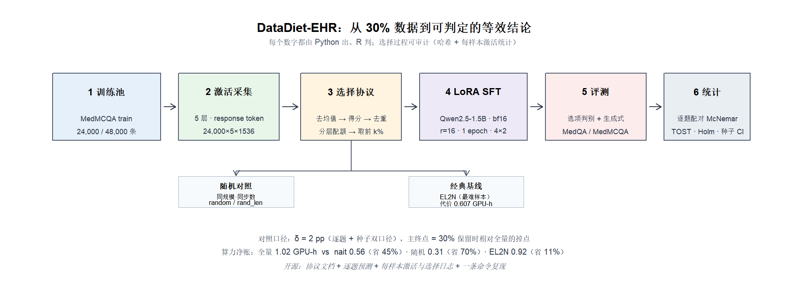
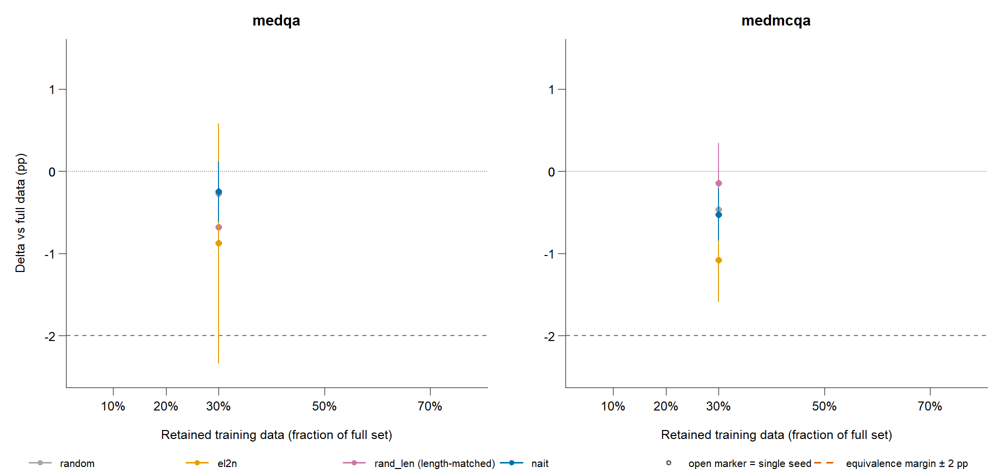
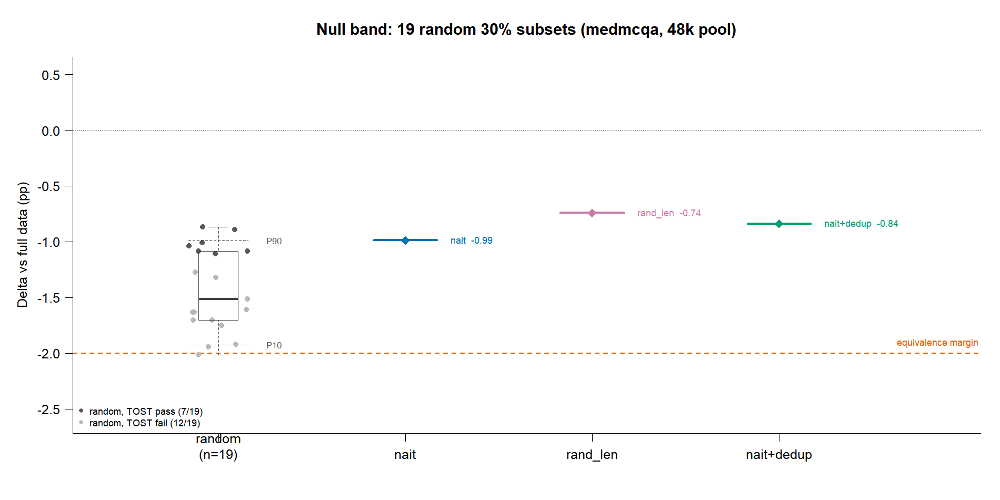
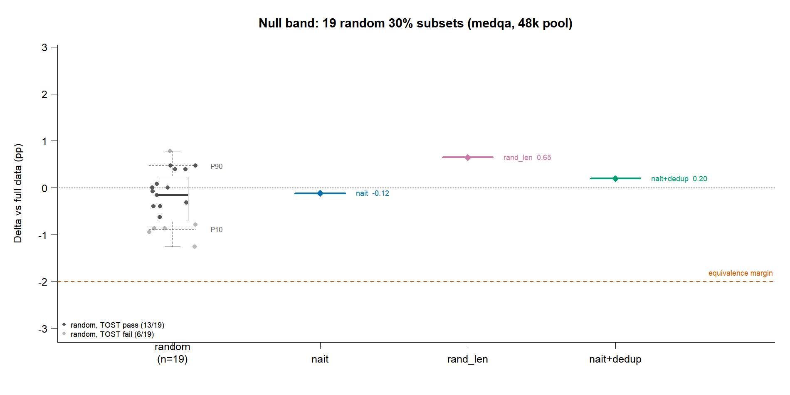
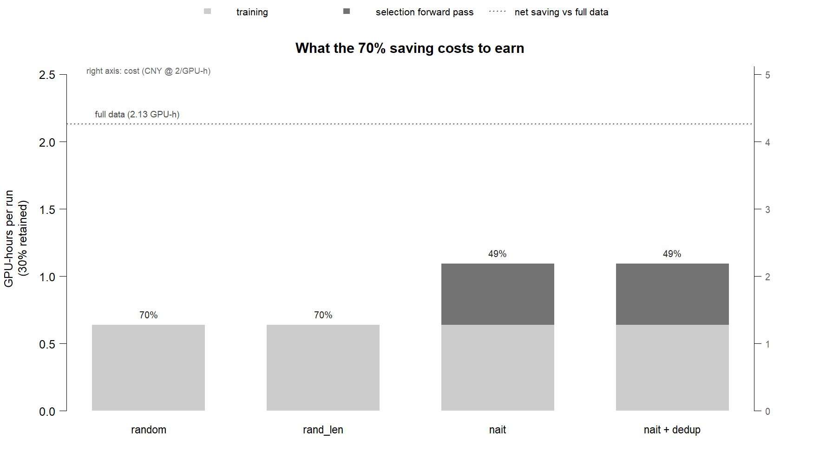
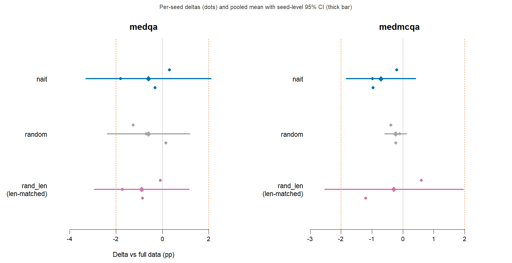
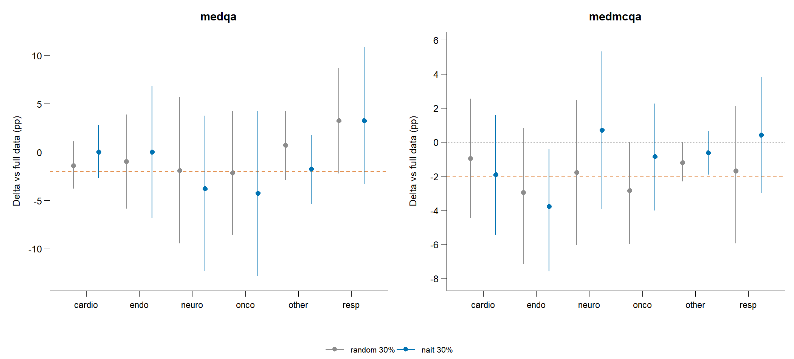
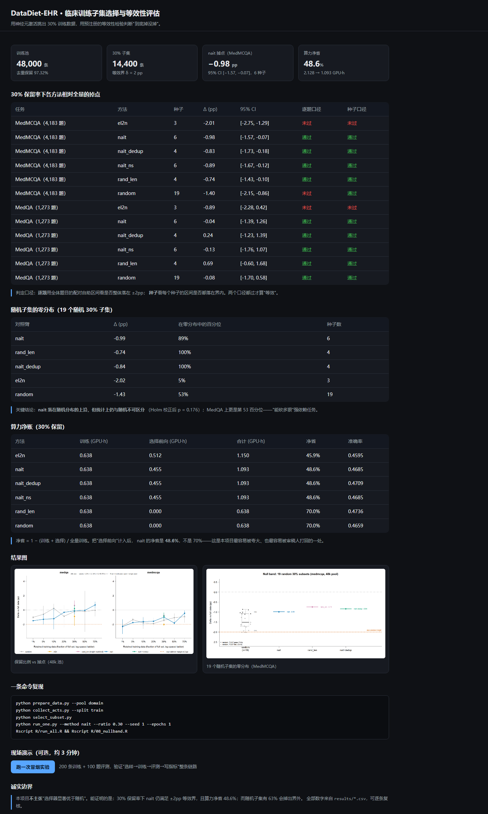

# 支撑材料

:: DataDiet-EHR：面向临床语言模型的可复现训练子集选择与等效性评估软件

> 本册是申报书的附件，只放"可核验的东西"：软著受理信息、开源归档、结果图表、复现命令、数据合规声明。正文论证见《研制报告》《研究报告》《项目书》，此处不重复。

---

## 一、软件著作权受理信息

| 项目 | 内容 |
|---|---|
| 软件全称 | DataDiet-EHR 临床训练子集选择与等效性评估软件 |
| 版本号 | V1.0 |
| 著作权人 | 杨宇（个人，单独开发） |
| 受理流水号 | **2026R11L3943354** |
| 受理状态 | 已提交、已受理；登记号待下发（普通通道 30–60 工作日，以中国版权保护中心为准） |
| 登记机关 | 中国版权保护中心（register.ccopyright.com.cn） |

> 说明：受理流水号可在版权保护中心"用户中心 → 我的登记"中查询核验；登记号下发后可向组委会补交。

## 二、开源仓库与归档

| 项目 | 内容 |
|---|---|
| 代码仓库 | <https://github.com/wyw-yy/datadiet-ehr> |
| 许可证 | MIT |
| 永久标识（Concept DOI） | **10.5281/zenodo.24161048** |
| 当前快照版本 | v1.0.4（版本 DOI `10.5281/zenodo.24161098`） |
| 交付包 | `dist/datadiet-ehr-v1.0.4.zip`（约 29 MB，含结果 CSV、逐题预测、文档、脚本） |
| 作者标识 | Yang, Yu — ORCID 0009-0002-6307-3373 |

归档包内每一份交付文件都带 sha256 清单（`dist/*.manifest.txt` 与 `docs/provenance.sha256`，共 17 条关键材料哈希），可逐项校验。

## 三、结果图表















## 四、核心数字（单源 `results/*.csv`）

| 指标 | 数值 | 出处 |
|---|---|---|
| 训练池规模 | 48,000 条（去重保留 46,714 / 97.32%） | `results/sample_stats.csv` |
| 30% 子集规模 | 14,400 条 | `data/subsets/subsets.json` |
| 全量基线训练开销 | 2.128 GPU·h（3 种子） | `results/compute_table.csv` |
| nait@30%（训练+选择） | 1.093 GPU·h，净省 **48.6%** | 同上 |
| nait@30% MedMCQA 掉点 | −0.98pp，95% CI [−1.57, −0.07]（6 种子） | `results/eq_table.csv` |
| 随机@30% MedMCQA 掉点 | −1.40pp，95% CI [−2.15, −0.86]（19 种子） | 同上 |
| 随机子集通过等效检验的比例 | 7 / 19 = 37%（MedMCQA）；13 / 19 = 68%（MedQA） | `results/nullband.csv` |

> 诚实边界：nait 与随机之差 +0.50pp，Holm 校正后 p = 0.176（不显著）。本项目**不主张**"选择器显著优于随机"，主张的是 30% 保留率下 nait 仍满足 ±2pp 等效界，且**这一点强依赖任务**（MedQA 上随机同样能过）。

## 五、复现命令（三条）

```bash
# 1) 造池 + 采激活 + 选子集（CPU 可完成，约 30 分钟）
python prepare_data.py --pool domain && python collect_acts.py --split train && python select_subset.py

# 2) 单次实验：训练 30% 子集并评测两个任务
python run_one.py --method nait --ratio 0.30 --seed 1 --epochs 1

# 3) 出全部统计图与表
Rscript R/run_all.R && Rscript R/08_nullband.R
```

## 六、数据合规声明

- 训练与评测**全部使用公开数据集**：HealthCareMagic-100k（`lavita/ChatDoctor-HealthCareMagic-100k`）、MedQA-USMLE、MedMCQA。
- **未使用任何真实病历**：未使用 MIMIC-IV，未使用任何院内电子病历，不涉及患者隐私与伦理审批。
- 原始数据不入库，仓库只保留转换后的 JSONL 与生成脚本；第三方材料（挑战杯通知附件）不入库。
- 所有数字由 `results/*.csv` 单源生成，文档中的每个数字都有审计脚本（`tools/audit_final.py`）可核对。

## 七、演示与说明材料

| 材料 | 状态 |
|---|---|
| 可执行软件 | 仓库 + 交付包，一条命令可复现 |
| 现场演示 | 建议演示：`python run_one.py --smoke --method full --seed 1`（约 3 分钟跑完并打印准确率） |
| 答辩 PPT | 另行准备（校赛决赛用） |
| 录像 | 待录（按需） |
| 图形界面（演示用） | `python app.py` 后浏览 `http://127.0.0.1:8765/`，无需安装任何依赖（纯标准库）；下图即该页面真实截图 |

下图是演示界面：四个关键数字、30% 保留的逐臂掉点表（含"逐题通过 / 24 个种子通过"两个判定口径）、
19 个随机子集构成的零分布对照、算力净账、复现命令，以及一个"跑一次冒烟实验"按钮
（点了会真的调用 `run_one.py --smoke`，约 3 分钟出结果）。

